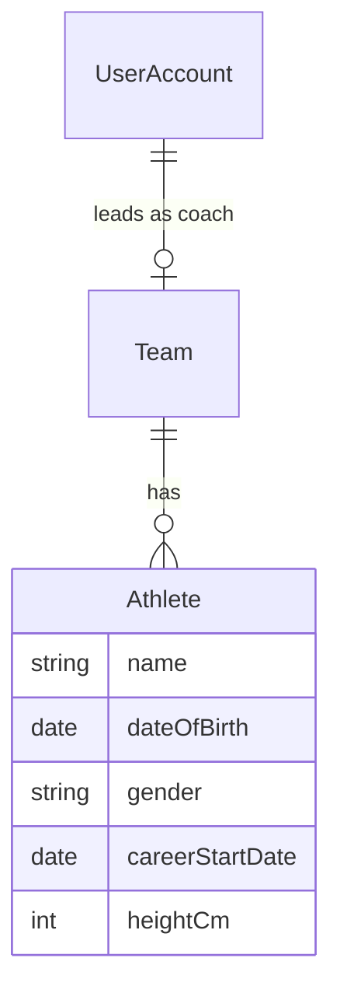

# Design

## Context

See proposal.md for motivation; requirements are in
`specs/athlete-management/spec.md` and the `authentication` delta. Built so
far: Google sign-in with `getCurrentUser` / `requireCurrentUser` in
`src/domain/auth`, the shared API error shape (`apiHandler`, `validate`,
`DomainError`), Drizzle with the auth tables, next-intl, Cache Components
(request data inside `<Suspense>`), the home page placeholder and a page
header with the language switcher.

User decisions that shape this change (2026-11-15): feature 3 before
feature 2; until roles exist, every signed-in user is the coach of their own
Team; a Team has one coach; a minimal athlete list on the home page plus an
edit form; gender is female, male or diverse.

## Goals / Non-Goals

**Goals:**
- Team and Athlete entities that feature 2 can extend (link to user
  account, invitations) without a data migration of existing rows.
- One validation definition for basic data, used by the API and producing
  field codes the UI can translate.

**Non-Goals:**
- Role model and athlete self-service (feature 2).
- Client-side validation beyond the browser's built-in input types; the
  server is the source of truth.

## Decisions

### Database tables

| Table | Columns | Notes |
|---|---|---|
| `team` | `id` uuid PK, `coach_id` text FK → `user_account.id` (cascade), unique; `created_at` | One Team per coach for now (unique), one coach per Team (user decision) |
| `athlete` | `id` uuid PK, `team_id` uuid FK → `team.id` (cascade), index; `name` text not null; `date_of_birth` date; `gender` enum `gender` (`female`, `male`, `diverse`); `career_start_date` date; `height_cm` smallint; `created_at`, `updated_at` | Optional columns are nullable |

- Team creation is idempotent: `insert … on conflict (coach_id) do nothing`
  followed by a select, so two parallel first requests cannot create two
  Teams.
- Ids are random UUIDs, so URLs do not reveal how many athletes exist.
- Feature 2 will add a nullable `user_account_id` to `athlete` and an
  `invitation` table; nothing here blocks that.
- Alternative: one table with the coach id on each athlete (no Team).
  Rejected: the glossary and domain model already use Team, and feature 2
  attaches roles to the Team.

### Domain layer: `src/domain/athletes`
- `getOrCreateTeam(coach: CurrentUser)`.
- `listAthletes(coach)`, `getAthlete(coach, id)`, `createAthlete(coach,
  input)`, `updateAthlete(coach, id, patch)`. Every function scopes its
  query by the coach's Team id; an athlete of another Team (or a malformed
  id) raises `DomainError("not_found", "ATHLETE_NOT_FOUND")` (spec: Access
  only to the own Team).
- `basicDataSchema` (Zod) defines the rules once:
  - `name`: trimmed, 1–100 characters.
  - `dateOfBirth`, `careerStartDate`: ISO dates `YYYY-MM-DD`, not after
    today; `careerStartDate` not before `dateOfBirth` (cross-field check).
  - `gender`: `female` | `male` | `diverse`.
  - `heightCm`: integer 100–250.
  - Create: `name` required, other fields optional or `null`. Update: every
    field optional (partial), `null` clears an optional value, `name` cannot
    be cleared.
  - Domain-specific failures use custom Zod issues with a stable code
    (`IN_FUTURE`, `BEFORE_DATE_OF_BIRTH`); `toFieldErrors` in
    `src/server/http` is extended to pass through a custom issue's code.
- "Today" is the current date in UTC on the server; good enough for
  birth and career dates.
- Sorting: `order by name` using the database collation (`en_US.utf8` in
  the PostgreSQL image), which sorts umlauts next to their base letters.

### HTTP API
| Method and path | Result |
|---|---|
| `GET /api/athletes` | 200, `{ athletes: Athlete[] }` sorted by name |
| `POST /api/athletes` | 201, created `Athlete` |
| `GET /api/athletes/{id}` | 200 `Athlete`, or 404 `ATHLETE_NOT_FOUND` |
| `PATCH /api/athletes/{id}` | 200 updated `Athlete`, 400 `VALIDATION_FAILED`, 404 |

`Athlete` JSON: `{ id, name, dateOfBirth, gender, careerStartDate, heightCm }`
with `null` for empty values. All endpoints use `requireCurrentUser`
(401 without session) and `apiHandler`.

### Pages
- `/` (home): server component; `getOrCreateTeam` via `listAthletes`,
  shows the names as links to `/athletes/{id}`, an "Add athlete" link to
  `/athletes/new`, and an empty-state note.
- `/athletes/new` and `/athletes/{id}`: one client form component
  (`AthleteForm`) with native inputs (`type="date"`, `type="number"`,
  a select for gender). It sends JSON to `POST /api/athletes` or
  `PATCH /api/athletes/{id}` and, on success, returns to `/`. On
  `VALIDATION_FAILED` it shows the translated message for each field code
  next to the field. This keeps the web UI on the same HTTP API that native
  apps will use.
- `/athletes/{id}` loads the athlete in a server component; for
  `ATHLETE_NOT_FOUND` it calls `notFound()`.
- A translated `src/app/not-found.tsx` replaces Next.js' English default
  page, since it now becomes reachable.
- Header: a `UserMenu` (small avatar, name, sign-out) joins the language
  switcher in the header of all signed-in pages; the sign-in page keeps the
  header with only the language switcher.
- Styling follows the existing minimalist black-and-white look (zinc tones,
  no accent colour); field errors use the existing red alert style.

### Testing
- Domain functions run against a real PostgreSQL engine in-process with
  PGlite (`@electric-sql/pglite` with Drizzle's PGlite driver) and the
  project's migrations, by mocking `@/server/db` in those tests. No Docker
  needed for `npm run check`. Alternative: a test database in the Compose
  PostgreSQL. Rejected: `npm run check` would depend on a running
  container.
- Covered: Team created once (also with parallel calls), create/list/get/
  update, validation rules and field codes, clearing values, cross-Team
  access returns `ATHLETE_NOT_FOUND`, sorting.
- Route tests for the four endpoints (status codes, 401, 400, 404).
- Component tests for `AthleteForm` (submit, field error display) and the
  athlete list (sorted names, empty state).

## Domain model changes

Team and Athlete move from "Draft" to "Current model". The relations to
user accounts for athletes and Invitations stay in the draft.

- Every user account leads at most one Team (created automatically for
  now); a Team has exactly one coach.
- An Athlete belongs to exactly one Team and is created by its coach.
- Email address and profile picture are part of an athlete's basic data but
  come from the linked user account (feature 2); they are not stored on the
  Athlete.

## Risks / Trade-offs

- [Every user gets a Team, also future athletes who sign in before being
  invited] → Feature 2 decides how to handle such empty Teams; they contain
  no athletes and cost nothing.
- [Database collation decides the sort order] → Acceptable for German and
  English names; switch to ICU collation if users report odd orders.
- [PGlite differs slightly from PostgreSQL 17] → It is PostgreSQL compiled
  to WebAssembly; the end-to-end check still runs against the real
  database.
- [No client-side validation] → Native input types prevent most mistakes;
  the server answers within one round trip.

## Migration Plan

New migration adds the `gender` enum and the `team` and `athlete` tables;
applied on container start. Rollback: drop the two tables and the enum.
