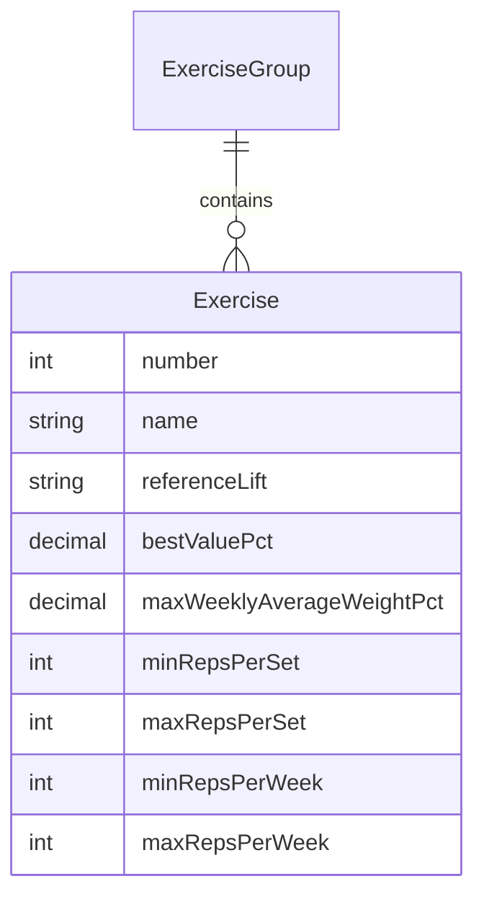

# Design

## Context

See proposal.md. Requirements: `exercise-catalog` (new), deltas for
`user-roles` (navigation) and `authentication` (account menu). The catalog
source is `Trainingsmittelkatalog.csv` (45 rows, German headers, comma
separated, UTF-8). English names are in `translations.md` and reviewed by
the user before implementation. User decisions (2026-11-15): one read-only
catalog for everyone, adjustable per athlete in a later change; bottom tab
bar on phones; typos fixed.

## Goals / Non-Goals

**Goals:**
- Exercises as database rows with stable ids, so plans and later
  per-athlete adjustments can reference them with foreign keys.
- The CSV stays the human-editable source of truth for the German content.

**Non-Goals:** editing in the app, search, per-athlete values.

## Decisions

### Source files
- `data/exercise-catalog/Trainingsmittelkatalog.csv`: the user's file,
  moved from the project root, with the typo fixes. German content.
- `data/exercise-catalog/translations.en.json`: English names for groups,
  exercises and comments, keyed by group number and catalog number.
- A script `npm run catalog:migration` parses both (with a small CSV parser
  that handles quoted fields), validates them (45 unique numbers, every
  exercise has an English name, numbers within ranges) and writes a
  Drizzle custom migration that upserts all rows. Committed like any other
  migration; re-run when the file changes.
- Alternative: reading the CSV at runtime. Rejected: plans need foreign
  keys to exercises, and the catalog must not change silently with a file
  edit on the server.

### Tables
| Table | Columns |
|---|---|
| `exercise_group` | `number` smallint PK (1–9), `code` text (`K1`), `name_de`, `name_en`, `sort_order` |
| `exercise` | `number` smallint PK (1–45, the catalog number), `group_number` FK, `name_de`, `name_en`, `reference_lift` enum (`snatch`, `clean_and_jerk`) null, `best_value_pct` numeric(5,1) null, `max_weekly_average_weight_pct` numeric(5,1) null, `min_reps_per_set`, `max_reps_per_set`, `min_reps_per_week`, `max_reps_per_week` smallint null, `comment_de`, `comment_en` text null |

The catalog number is the primary key: it is stable, short and what coaches
use ("number in the catalog", feature 9). Percentages are numeric so later
values like 87.5 % fit.

### Domain and API
- `src/domain/exercises`: `getCatalog()` returns groups in order with their
  exercises (both languages), `getExercise(number)` (`EXERCISE_NOT_FOUND`
  for unknown numbers).
- `GET /api/exercises`: `{ groups: [{ number, code, name: { de, en },
  exercises: [{ number, name: { de, en }, referenceLift, bestValuePct,
  maxWeeklyAverageWeightPct, repsPerSet: { min, max }, repsPerWeek: { min,
  max }, comment: { de, en } | null }] }] }`. Signed-in users only (401
  otherwise), `cache-control: private, max-age=3600` since it rarely
  changes.

### Catalog page `/exercises` and exercise page `/exercises/{number}`
(Layout decided by the user after the first plan: list with number, name,
group and best value; every exercise clickable for all information.)
- `/exercises`: server component for every signed-in user (no role
  needed); texts in the current locale. One list in catalog order, each
  row a link with four parts: number, name, group and best value. The
  group shows its code (`K3`) on phones and code plus name from `md` up;
  the best value is right-aligned (`108 %`, `–` when empty). No table and
  no fixed widths, so nothing scrolls sideways.
- `/exercises/{number}`: all information as a definition list: number,
  name, group (code and name), reference lift, best value, max. weekly
  average weight, reps per set (`3–8`), reps per week (`18–48`) and
  comment; empty values shown as "not defined". A link back to the
  catalog. Unknown or malformed numbers → `notFound()`.
- A separate page (not an expanding row or dialog) so later planning views
  can link to an exercise directly, and the browser's back button works.
- Percent and number formatting through next-intl (German decimal comma).

### Navigation
- `AppNavigation` (client, `usePathname`) receives the roles from the
  signed-in layout and renders the tabs: "Athletes" (`/`, coaches),
  "My training" (`/training`, athletes), "Exercises" (`/exercises`).
  The athlete details and basic data pages count as "Athletes".
- Phones (below `sm`): fixed bar at the bottom with icon-free text tabs,
  safe-area padding (`env(safe-area-inset-bottom)`) and page bottom
  padding so content is not hidden. From `sm`: the same tabs in the header
  on the left (where the role switch was). Minimal black and white style.
- `aria-label` on the `nav`, `aria-current="page"` on the current tab.
- Users without a role (start choice) see only "Exercises".
- The language switcher moves into the account menu (below the email,
  above "Sign out"); the root footer is shown only on pages without a
  signed-in header (sign-in, not-found when signed out). Implemented by
  moving the footer from the root layout into those pages.

## Domain model changes

- The exercise catalog consists of exercise groups (K1–K9), each with its
  exercises. Exercises are identified by their catalog number.
- The catalog is shared by all Teams. Later changes reference exercises from
  mesocycles and weekly plans and add per-athlete adjustments of the values.

## Risks / Trade-offs

- [Translations of specialist terms may be off] → User reviews
  `translations.md` before implementation; texts live in one JSON file.
- [Catalog updates need a new migration] → One script generates it from the
  files; the upsert keeps exercise numbers (and later references) stable.
- [Fixed bottom bar can cover content or the iOS home indicator] → Bottom
  padding on pages and safe-area insets.

## Migration Plan

Schema migration plus the generated data migration; both run on container
start. Rollback: drop the two tables and the enum.
