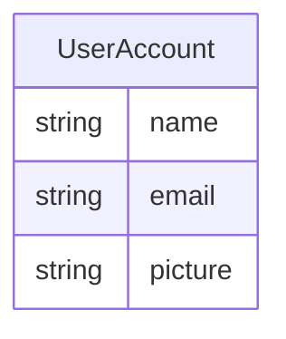

# Design

## Context

See proposal.md for motivation and `specs/authentication/spec.md` for the
requirements. Built so far (archived `add-project-scaffolding`):

- Next.js 16 with Cache Components. The root layout renders everything that
  reads request data inside `<Suspense>`, so pages may read cookies and
  headers.
- Layering: business rules in `src/domain`, thin route handlers using
  `apiHandler` and the shared error shape from `src/server/http`,
  `DomainError` kinds mapped to HTTP status codes (`unauthenticated` → 401).
- Drizzle + PostgreSQL with an empty schema; migrations run on container
  start.
- HTTPS everywhere: dev server on `https://localhost:3000`, Docker stack on
  `https://localhost`, both with untrusted local certificates.
- The project context names Better Auth as the authentication library.

## Goals / Non-Goals

**Goals:**
- One place that answers "who is the current user?" for pages, route
  handlers and later domain functions.
- Session handling that a future native app can reuse through the HTTP API
  without changing the domain layer.

**Non-Goals:**
- Authorization rules beyond "signed in or not" (they come with roles).
- Bearer-token authentication for native apps.

## Decisions

### Better Auth with the Drizzle adapter and database sessions
- Configured in `src/server/auth/auth.ts` with `drizzleAdapter` (provider
  `pg`), the Google social provider, and no email/password.
- Sessions are stored in the database (revocable, so sign-out ends exactly
  that session) and referenced by an HttpOnly cookie. Secure cookies are
  forced (`__Secure-` prefix, `Secure`, `SameSite=Lax`) since the app only
  runs over HTTPS.
- Session lifetime: `expiresIn` 30 days, `updateAge` 1 day. Each use of the
  app at most once a day moves the expiry 30 days ahead (spec: Session
  lifetime).
- Google profile name and picture are updated on every sign-in via the
  Google provider's option to override user info on sign-in. Email is taken
  from the Google profile; Google accounts with unverified email addresses
  are rejected.
- Better Auth's built-in rate limiting stays on (in-memory storage; enough
  for one app instance).
- Alternative: Auth.js. Rejected: the project context names Better Auth, and
  Better Auth's Drizzle adapter and session API fit the domain-layer pattern.

### Database tables
Generated with the Better Auth CLI into `src/server/db/schema/auth.ts`, then
a Drizzle migration via `npm run db:generate`. Model names are mapped so the
code uses project terms:

| Better Auth model | Table | Purpose |
|---|---|---|
| user | `user_account` | The user account (domain entity) |
| session | `session` | Active sessions (technical) |
| account | `oauth_account` | Link from a user account to its Google account (technical) |
| verification | `verification` | Short-lived OAuth state values (technical) |

Renaming `account` avoids confusion with "user account".

### HTTP routes
- `src/app/api/auth/[...all]/route.ts`: Better Auth's handler
  (`toNextJsHandler`). Provides sign-in, OAuth callback
  (`/api/auth/callback/google`), sign-out and session endpoints.
- `GET /api/me`: thin route handler calling the domain function
  `requireCurrentUser`; returns `{ id, name, email, image }` or the shared
  401 `UNAUTHENTICATED` error.

### Domain layer: `src/domain/auth`
- `getCurrentUser(headers: Headers): Promise<CurrentUser | null>` reads the
  session through `auth.api.getSession({ headers })` and returns only the
  fields the app needs.
- `requireCurrentUser(headers)` throws
  `DomainError("unauthenticated", "UNAUTHENTICATED")` when there is none.
- `safeReturnPath(value): string` accepts only same-origin relative paths
  (starting with a single `/`, not `//` or `/\`, not `/api/` or
  `/sign-in`) and otherwise returns `/` (spec: Return target outside the app
  is ignored).
- Pages call these with `await headers()`; route handlers pass
  `request.headers`. The domain code depends on the standard `Headers`
  type only, not on Next.js.

### Page protection: proxy plus server-side check
- `src/proxy.ts` (Next.js 16's replacement for middleware) does an
  optimistic check: if the session cookie is missing and the path is not
  `/sign-in`, `/api/*` or a static asset, it redirects to
  `/sign-in?returnTo=<path and query>`. It does not hit the database.
- Every protected page also calls `getCurrentUser` and redirects to
  `/sign-in?returnTo=…` if the session is invalid or expired. This is the
  real check; the proxy only avoids rendering protected pages for obviously
  signed-out visitors.
- `/sign-in` redirects signed-in users to `safeReturnPath(returnTo)`.
- With Cache Components, the session read happens inside the existing
  `<Suspense>` boundary of the root layout. No `use cache` is used for
  session-derived data in this change.

### Sign-in and sign-out UI
- Sign-in page: app name, a "Continue with Google" button following
  Google's branding guidelines (Google "G" logo, official wording
  translated), the language switcher, and an error message area.
- The button uses Better Auth's React client:
  `signIn.social({ provider: "google", callbackURL: safeReturnPath(returnTo),
  errorCallbackURL: "/sign-in" })`. Better Auth appends `?error=<code>` to
  the error URL. `access_denied` (user cancelled at Google) shows the
  "not completed" message; every other code shows the generic "failed"
  message. Error codes are never shown to the user.
- Home page (`/`): avatar (Google picture via `next/image`, with
  `*.googleusercontent.com` allowed as remote image host; initials when
  there is no picture), the user's name, a sign-out button, and the
  language switcher.
- Sign-out button calls the client's `signOut()` (the HTTP API endpoint)
  and then navigates to `/sign-in`.

### Configuration
New environment variables (documented in `.env.example`):

| Variable | Dev (`.env`) | Docker Compose |
|---|---|---|
| `BETTER_AUTH_SECRET` | random, ≥ 32 chars | from `.env` |
| `BETTER_AUTH_URL` | `https://localhost:3000` | set by Compose to `https://${APP_DOMAIN}` |
| `GOOGLE_CLIENT_ID` | from Google Cloud | from `.env` |
| `GOOGLE_CLIENT_SECRET` | from Google Cloud | from `.env` |

The Google OAuth client (type "Web application") needs these authorized
redirect URIs: `https://localhost:3000/api/auth/callback/google` and
`https://localhost/api/auth/callback/google`; the production domain is added
with the VPS change. While the OAuth consent screen is in "Testing" mode,
only Google accounts listed as test users can sign in.

### Testing
- Unit tests: `safeReturnPath`, `getCurrentUser`/`requireCurrentUser` with
  a stubbed `auth.api.getSession`, `GET /api/me` (200 and 401), the proxy
  redirect logic, the sign-in error message mapping, the avatar fallback.
- Better Auth configuration test: session lifetime values, secure cookie
  attributes, only the Google provider enabled.
- The real Google sign-in is verified manually in the dev server and in the
  Docker stack (it needs a browser and a real Google account).

## Domain model changes

The user account moves from "Draft" to "Current model". Its relations to
Team and Athlete stay in the draft until features 2 and 3 build them.
Sessions and linked Google accounts are technical and not part of the
conceptual domain model.

- A user account is created by the first sign-in with Google and identified
  by that Google account. Name and picture follow the Google profile.
- A user account has no role by itself.

The open questions in `domain-model.md` (coaches per Team, Athletes in
several Teams, Invitation reuse/expiry) are not affected by this change.

## Risks / Trade-offs

- [Google rejects the redirect URI or the untrusted local certificate breaks
  the callback] → The redirect is a browser navigation, so an accepted
  certificate warning is enough; the redirect URIs must match exactly
  (scheme, host, port, path).
- [The proxy's cookie check can be fooled by any cookie with the session
  name] → It only decides whether to render the sign-in page early; data
  access always re-checks the session in the domain layer.
- [In-memory rate limiting resets on restart and does not work across
  several instances] → Acceptable for a single instance; revisit with
  horizontal scaling.
- [Profile pictures are loaded from Google's servers through the Next.js
  image optimizer] → No browser request goes to Google, but the server
  fetches the picture; acceptable. Copying pictures into our own storage is
  part of feature 3 if needed.
- [OAuth consent screen in "Testing" mode limits sign-in to test users] →
  Fine for development; publishing the consent screen is part of going
  public.

## Migration Plan

The first real migration creates the four tables. It runs automatically on
container start; locally with `npm run db:migrate`. No existing data.
Rollback: drop the four tables.
