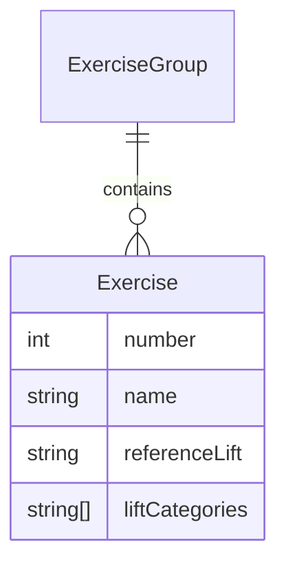

# Design

## Context

See proposal.md - Why.

- **Catalog source:** the catalog is built from
  `data/exercise-catalog/Trainingsmittelkatalog.csv` plus
  `translations.en.json`. `npm run catalog:migration`
  (`scripts/catalog-migration.ts` → `src/server/catalog/catalog-source.ts`)
  turns it into an idempotent data migration that upserts `exercise_group`,
  `exercise` and the tags (`0012_exercise_catalog_data.sql` and later).
- **Shared type:** `Exercise` in `src/domain/exercises/catalog-types.ts` is
  used by server and UI.
- **Where exercises are drawn:** the week editor (`exercise-list.tsx`,
  `session-card.tsx`, `session-table.tsx`), the week view
  (`week-view-table.tsx`), the catalog page (`src/components/exercises/`)
  and the exercise chart (`exercise-chart.tsx` → `week-chart.tsx`). The
  chart's curve and gradient colour is the CSS token `--chart-curve`.

## Goals / Non-Goals

**Goals:**
- One source of truth for the categories (the catalog CSV) and one mark
  component used everywhere.

**Non-Goals:**
- Category-based validation or warnings in the week editor (e.g. "two
  cleans on Monday").

## Decisions

1. **Data: `exercise.lift_categories text[] not null default '{}'`.**
   - **Values:** `snatch`, `clean` and `jerk`, stored in that order.
   - **Migrations:** a drizzle schema migration adds the column.
     `catalog-source.ts` parses the new CSV column "Kategorie" (German
     values `Reißen`, `Umsetzen`, `Ausstoßen`, comma-separated, empty
     allowed) and the regenerated data migration writes it in the
     exercise upsert.
   - **Validation:** an unknown value fails the build of the migration.
   - **Alternatives:** a join table is overkill for three fixed values; a
     Postgres enum array adds enum migration overhead; deriving the
     categories from the reference lift and the name is unreliable (e.g.
     squats, exercise 29).

2. **Type `LiftCategory = "snatch" | "clean" | "jerk"`;
   `Exercise.liftCategories: LiftCategory[]`.** The catalog query maps the
   column; the API returns it unchanged.

3. **`LiftMarks` component** (`src/components/exercises/lift-marks.tsx`).
   - **Look:** one `size-2.5` rounded dot per category, coloured with the category's colour token.
   - **Accessibility:** each dot has a `title` and an sr-only text with
     the category name, and the dots are wrapped in a span with
     `data-lift-marks`.
   - **Placement:** it renders nothing for no category and goes before the
     name in every place listed in the proposal.
   - **Alternative:** a coloured left border on rows reads well in lists
     but not for two categories or on session cards.

4. **Colour tokens.** `--lift-snatch: var(--color-palette-cyan)`,
   `--lift-clean: var(--color-palette-purple)` and `--lift-jerk:
   var(--color-palette-magenta)`, the same in both modes (user decision).

5. **Chart colour.**
   - **Parameter:** `WeekChart` gets a `color` prop (a CSS colour, default
     `var(--chart-curve)`), used for the stroke, the gradient stops and the
     hover dot.
   - **Exercise chart:** `ExerciseChart` passes the first category's token,
     or `var(--chart-ink)` without a category. It needs the selected
     exercise's categories; the macrocycle view and the athlete page
     already have the exercise list, which now carries `liftCategories`.

## Domain model changes

`Exercise` (catalog) gains the attribute `liftCategories` — the Lift
categories (snatch, clean, jerk) it trains:

## Risks / Trade-offs

- **[Risk]** Purple `#6f3ab1` on the dark surface has low contrast (under
  3:1). → The marks are not text, they carry an accessible name, and the
  curve also has its gradient; the colours are a user decision.
- **[Risk]** Jerk magenta equals the planning chart's magenta. → Different
  screens: the planning chart has no exercise. This is noted in the
  proposal for review.
- **[Trade-off]** Regenerating the data migration rewrites all catalog
  rows. → The migration is an idempotent upsert, as before.

## Migration Plan

1. Run the schema migration (new column, default `{}`).
2. Run the regenerated data migration (fills the column).

Rollback: drop the column. The old data migration still works without it.
