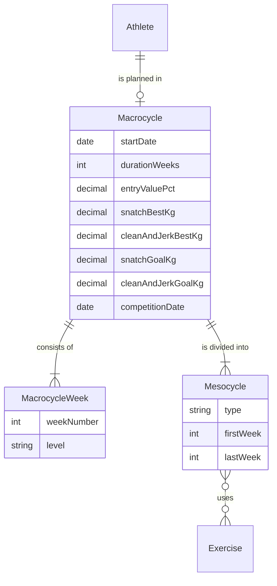

# Design

## Context

See proposal.md; requirements in the `macrocycle-planning`,
`macrocycle-calculation` and `athlete-details` deltas. Built so far: Team,
Athlete, the exercise catalog (`exercise` with best value, max. weekly
average weight, reps per set/week, reference lift; catalog number as key),
the athlete details page `/athletes/{id}` (header only), coach-only pages
via `requireCoachPage`, forms keyed by `bfcacheId`, PGlite tests, the
minimalist black-and-white UI and the tab navigation. The calculation rules
were given by the user on 2026-11-16 (sine curve, ±5 points, t = (k−1)/(N−1),
mesocycle split 15/50/35, volume = sum of weekly reps).

## Goals / Non-Goals

**Goals:**
- One pure calculation module used by API, pages and later the weekly
  planning, so all screens show the same numbers.
- Store only what the coach decides (base data, week levels, mesocycle
  borders and exercises); calculate everything else on read.

**Non-Goals:** macrocycle view (feature 7), athlete access, several cycles,
adjustable mesocycle borders, taper/transition blocks.

## Decisions

### Tables
| Table | Columns |
|---|---|
| `macrocycle` | `id` uuid PK; `athlete_id` uuid FK → `athlete` (cascade), **unique**; `start_date` date; `duration_weeks` smallint; `entry_value_pct` numeric(4,1); `snatch_best_kg`, `clean_and_jerk_best_kg`, `snatch_goal_kg`, `clean_and_jerk_goal_kg` numeric(5,1); `body_weight_kg`, `target_body_weight_kg` numeric(5,1); `body_fat_pct`, `muscle_mass_pct` numeric(4,1) null; `deficits`, `injuries_and_illnesses`, `strengths`, `experience`, `competition_type` text; `training_frequency` smallint; `focus_points` text[] (1–3, ordered); `competition_date` date; `created_at`, `updated_at` |
| `macrocycle_week` | PK (`macrocycle_id`, `week_number`); `level` enum `week_level` (`high`, `medium`, `low`) |
| `mesocycle` | `id` uuid PK; `macrocycle_id` FK (cascade); `type` enum `mesocycle_type` (`general_preparation`, `special_preparation`, `competition_preparation`); `first_week`, `last_week` smallint; unique (`macrocycle_id`, `type`) |
| `mesocycle_exercise` | PK (`mesocycle_id`, `exercise_number`); `exercise_number` FK → `exercise.number` |

- Unique `athlete_id` enforces one macrocycle per athlete (409
  `MACROCYCLE_EXISTS`).
- All week rows exist (N rows) so levels are explicit; changing the duration
  keeps existing levels, adds medium weeks or removes surplus weeks, and
  re-divides the mesocycles by default while keeping each mesocycle's
  exercises (they belong to the mesocycle type).
- Mesocycle borders are stored and adjustable in step 2 (added during
  acceptance). A duration change scales the stored block lengths:
  `general = max(1, round(g·N′/N))`, `special = max(1, round(s·N′/N))`,
  reduced if needed so that `competition = N′ − general − special ≥ 1`.

### Calculation module `src/domain/macrocycles/calculation.ts` (pure)
- `cycleProgress(k, N) = (k−1)/(N−1)`.
- `curveShape(t) = (sin(t·π − π/2) + 1) / 2` (0 → 1).
- `intensity(E, t, level) = E + (1 − E)·curveShape(t) + {high: +0.05, low:
  −0.05, medium: 0}` — algebraically identical to the user's formula.
- `plannedBestKg = roundKg(intensity × bestValuePct/100 × goal)`,
  `plannedAverageKg` likewise with `maxWeeklyAverageWeightPct`; null when a
  value or the reference lift is missing.
- `plannedSetSize = round(max − (max − min)·curveShape(t))`;
  `plannedWeeklyReps = round((max − (max − min)·curveShape(t)) × {high:
  1.05, low: 0.95, medium: 1})`; null without catalog reps.
- `volume(week) = Σ plannedWeeklyReps` of the week's mesocycle exercises
  (null when the mesocycle has none, exercises without reps count 0).
- `splitMesocycles(N)`: general `floor(0.15N)`, special `floor(0.5N)`,
  competition the rest.
- Rounding: weights to whole kilograms and reps to whole numbers, halves
  up (user decision), intensity shown with one decimal. Floating-point results are rounded
  before comparison in tests.
- Exhaustive unit tests with the spec's example values.

### Domain functions `src/domain/macrocycles`
`getMacrocycle(coach, athleteId)` (with calculated `weeks[]`: number,
start date, mesocycle, level, intensity, volume, and per mesocycle exercise
the planned values), `createMacrocycle`, `updateBaseData`, `setWeekLevel`,
`setMesocycleExercises`. All scoped through `requireCoachTeam` and the
athlete's Team (`ATHLETE_NOT_FOUND` otherwise); validation with Zod in the
domain (`DomainValidationError`), including "start date is a Monday",
ranges and `MACROCYCLE_EXISTS`.

### HTTP API
| Method and path | Purpose |
|---|---|
| `GET /api/athletes/{id}/macrocycle` | macrocycle with calculated weeks (404 `MACROCYCLE_NOT_FOUND`) |
| `POST /api/athletes/{id}/macrocycle` | step 1, create (201; 409 `MACROCYCLE_EXISTS`) |
| `PATCH /api/athletes/{id}/macrocycle` | step 1, change base data |
| `PUT /api/athletes/{id}/macrocycle/weeks/{week}` | `{ level }` |
| `PUT /api/athletes/{id}/macrocycle/mesocycles/{type}/exercises` | `{ exerciseNumbers }` |
| `PUT /api/athletes/{id}/macrocycle/mesocycles/borders` | `{ specialPreparationStart, competitionPreparationStart }` (week numbers; each block ≥ 1 week) |

### Pages (coach only, under the athlete)
- `/athletes/{id}/macrocycle/base-data`, `/intensity`, `/exercises`, with a
  step indicator (1 · 2 · 3) and "Continue" / "Back"; "Finish" in step 3
  returns to `/athletes/{id}`. Steps 2 and 3 need an existing macrocycle
  (otherwise redirect to step 1).
- Base data form: same pattern as the athlete form (native inputs,
  `noValidate`, server field errors, keyed by `bfcacheId`); the date input
  for the start date offers the next Monday by default.
- Exercise selection: the catalog grouped by exercise group with a checkbox
  per exercise, one tab per mesocycle; saved per mesocycle.
- Athlete details page: macrocycle section (placeholder) with "Plan
  macrocycle" or period, competition and "Change planning".

### Macrocycle chart (custom SVG, no chart library)
(Adjusted after loading the `dataviz` skill: no second y-axis. Intensity and
volume are two charts stacked on the same week axis in one scroll container,
plus a tooltip per week and a table view.)
- Follows the `dataviz` skill's guidance (to be loaded before writing the
  chart): x = weeks (labels every few weeks, calendar week numbers),
  left y-axis intensity 50–110 %, line with a handle (circle, ≥ 44 px touch
  target) per week; volume as a separate bar chart below (same columns)
  once exercises exist; mesocycle bands as three neutral grey shades behind the plot with a
  legend (staying in the black-and-white style); high/low weeks additionally
  marked with ▲/▼ above/below the handle so the level is not conveyed by
  position alone.
- Handles: pointer drag snaps to the three positions (curve −5, curve,
  curve +5); a tap on the upper or lower half of a week's column moves one
  step; each handle is a focusable `role="slider"` with `aria-valuetext`
  ("Week 11, high, 85 %") and arrow keys. Each change calls the week API
  immediately (optimistic update, reverted with a message on failure).
- Width: at least 28 px per week; wider cycles scroll horizontally inside
  the chart container on phones (the page itself does not scroll sideways).

### Styling
Minimalist black and white, except the mesocycle bands, which the user
asked to be muted red (general preparation), yellow (special preparation)
and green (competition preparation), with light and dark variants as CSS
variables. They are background tints with low chroma, so the black/white
curve, handles and labels keep their contrast; the legend and the band
labels name the blocks, so identity never relies on colour alone.

### Border handles and tooltip placement (added during acceptance)
- Each of the two borders is a vertical hairline across the intensity chart
  with a grip at the top (≥ 44 px touch target), `role="slider"` with
  `aria-valuetext` ("Special preparation block from week 4") and
  left/right arrow keys. Dragging snaps to week boundaries and stops so
  every block keeps at least one week; on release the new borders are saved
  (optimistic, reverted on failure).
- The tooltip is placed away from the hovered point: horizontally on the
  side of the point with more room (left of points in the right half), and
  vertically in the half of the plot the point is not in, so it covers
  neither the point nor the pointer, which is on the point's column.

## Domain model changes

- An Athlete has at most one Macrocycle; it belongs to the athlete's Team
  and is planned by its coach.
- A Macrocycle consists of its weeks (each high, medium or low) and is
  divided into three Mesocycles: general preparation, special preparation
  and competition preparation block.
- A Mesocycle uses exercises from the exercise catalog; the same exercise
  can be used in several mesocycles.
- Intensity, planned weights, reps and volume are calculated, not stored.

## Risks / Trade-offs

- [Drag handles are fiddly on phones with many weeks] → Minimum week width
  with horizontal chart scrolling, large touch targets, tap and keyboard
  alternatives.
- [Assumptions in the proposal may be wrong] → They are isolated in the
  calculation module and the validation schema; tests name them.
- [Changing the duration re-divides mesocycles] → Exercises stay with their
  mesocycle type; week levels stay by week number.
- [Floating-point rounding (e.g. 5.5 → 6, 136.5 → 137)] → Explicit rounding
  helpers with tests at the spec's example values.

## Migration Plan

One schema migration (four tables, two enums). Rollback: drop them.
