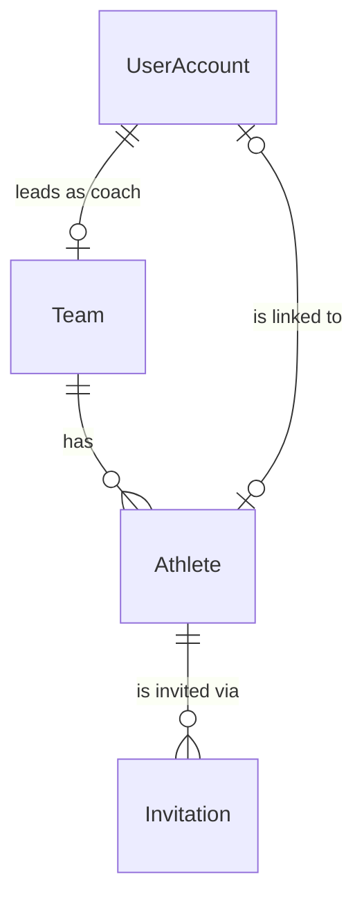

# Design

## Context

See proposal.md for motivation; requirements are in the `user-roles` and
`athlete-invitations` specs and the deltas for `athlete-management` and
`authentication`. Built so far: Google sign-in, Team (unique `coach_id`)
and Athlete tables, `getOrCreateTeam` creating Teams on every page visit,
athlete list and form, `DomainError` kinds mapped to HTTP status codes,
PGlite database tests, and Next.js 16 with Cache Components (pages keep
their state across navigations; forms are keyed by `bfcacheId`).

User decisions (2026-11-15): one coach per Team; a user account is linked
to at most one Athlete; invitations are single-use, valid 7 days, replaced
by a newer one; "This is me" for coaches; one user can be coach of one Team
and athlete in another; athletes see a placeholder view; empty automatic
Teams are removed.

## Goals / Non-Goals

**Goals:**
- Roles derived from data (leading a Team, being linked to an Athlete), so
  there is no separate role table that could disagree with the data.
- Invitation links that are safe to share: unguessable, single-use,
  short-lived, and stored only as a hash.
- Race-free acceptance: two people can never be linked to the same
  Athlete, and nobody to two Athletes.

**Non-Goals:**
- Unlinking, invitations by email, several coaches per Team.

## Decisions

### Database changes
- `athlete.user_account_id` text, nullable, **unique**, FK →
  `user_account.id` (`on delete set null`). Unique enforces "at most one
  Athlete per user account" in the database.
- New table `invitation`:

  | Column | Type | Notes |
  |---|---|---|
  | `id` | uuid PK | |
  | `athlete_id` | uuid FK → `athlete.id` (cascade), index | |
  | `token_hash` | text, unique | SHA-256 (hex) of the token |
  | `created_by` | text FK → `user_account.id` (cascade) | the coach |
  | `expires_at` | timestamptz | created + 7 days |
  | `revoked_at` | timestamptz, null | set when a newer invitation replaces it |
  | `accepted_at`, `accepted_by` | timestamptz / text FK, null | set on acceptance |
  | `created_at` | timestamptz | |

  Revoked invitations are kept (not deleted) so an old link can say "no
  longer valid" instead of "not valid".
- A hand-written data migration deletes Teams without athletes
  (`delete from team where not exists (select 1 from athlete where
  athlete.team_id = team.id)`), generated with `drizzle-kit generate
  --custom`.

### Tokens and links
- Token: 32 random bytes from `crypto.getRandomValues`, base64url (43
  characters). Only its SHA-256 hash is stored; the plain token exists only
  in the link shown to the coach. A database leak therefore exposes no
  usable links.
- Link: `${BETTER_AUTH_URL}/invite/{token}` (the app's public URL, already
  configured per environment). A small `appUrl()` helper in
  `src/server/config.ts` reads it.
- Lookup by hash; the token is never logged.

### Domain layer
- `src/domain/roles`:
  - `getRoles(user)` → `{ coach: { teamId } | null, athlete: { athleteId,
    athleteName, teamId, coachName } | null }`.
  - `startAsCoach(user)` → Team (idempotent insert on the unique
    `coach_id`; replaces `getOrCreateTeam`).
  - `requireCoachTeam(user)` → Team, or `DomainError("forbidden",
    "NOT_A_COACH")`. All athlete functions use it instead of creating a
    Team.
- `src/domain/invitations`:
  - `createInvitation(coach, athleteId, now)` → `{ token, expiresAt }`;
    refuses linked athletes (`ATHLETE_ALREADY_LINKED`, 409); revokes the
    athlete's open invitations in the same transaction.
  - `getInvitation(token, now)` → `{ status: "valid" | "expired" |
    "used", coachName, athleteName }` or `INVITATION_NOT_FOUND` (404).
  - `acceptInvitation(user, token, now)`: in one transaction, (1)
    conditional update `set accepted_at … where token_hash = … and
    accepted_at is null and revoked_at is null and expires_at > now
    returning athlete_id`; zero rows → `INVITATION_EXPIRED` or
    `INVITATION_USED` (410); (2) `update athlete set user_account_id = user
    where id = … and user_account_id is null`; a unique violation on
    `user_account_id` → `ALREADY_LINKED` (409) and the transaction rolls
    back, so the invitation stays valid.
  - `linkSelf(coach, athleteId)`: same athlete update for an athlete of the
    coach's own Team (`ALREADY_LINKED`, `ATHLETE_ALREADY_LINKED`).
  - `now` is a parameter (defaulting to the current time) so tests can
    check expiry without waiting.
- `DomainErrorKind` gains `gone` → HTTP 410.
- `Athlete` (API shape) gains `linkedAccount: { email, image } | null`,
  joined from `user_account`.

### HTTP API
| Method and path | Result |
|---|---|
| `GET /api/me` | now also `roles` (see `getRoles`) |
| `POST /api/team` | start as coach: 201 with the Team (200 if it existed) |
| `POST /api/athletes/{id}/invitations` | 201 `{ url, expiresAt }` |
| `POST /api/athletes/{id}/link-self` | 200 updated athlete |
| `GET /api/invitations/{token}` | 200 `{ status, coachName, athleteName }`, 404 |
| `POST /api/invitations/{token}/accept` | 200 `{ athleteId }`, 404/409/410 |
| `/api/athletes…` (existing) | 403 `NOT_A_COACH` without a Team |

### Pages and navigation
- `/`: users without a role see the start choice; coaches see the athlete
  list; users who are only athletes are redirected to `/training`.
- `/start/athlete`: a text field for the invitation link. The client
  accepts only a URL of this app's origin with the path `/invite/{token}`
  and navigates there; anything else shows a message.
- "Start as Coach" calls `POST /api/team` and refreshes `/`.
- `/invite/{token}`: shows the invitation state. Valid → "Max Berg invites
  you as Anna Weber" with "Accept"; already linked user → explanation, no
  button; expired/used/unknown → message to ask the coach for a new link.
  Signed-out visitors are sent to sign-in by the existing proxy and return
  here (`returnTo`).
- `/training`: athlete placeholder view (athlete name, profile picture,
  coach name); users without the athlete role are redirected to `/`.
- `/athletes/new` and `/athletes/{id}` stay coach-only (redirect to `/`
  for users without a Team).
- Edit page additions: a "Linked" section with the account's email and
  picture for linked athletes; for unlinked athletes an "Invite" button
  and, if the coach is not linked anywhere, "This is me".
- Invitation panel (client component): calls `POST
  /api/athletes/{id}/invitations`, then shows the link in a read-only field,
  its expiry date and "Copy link" (`navigator.clipboard.writeText`,
  confirmation "Copied"). Used on the edit page ("Invite") and on the new
  athlete page after "Save and invite" (athlete created first, then the
  invitation; the panel replaces the form, with "Done" back to the list).
  The panel is keyed by `bfcacheId` like the form, so a revisited page does
  not show an old link.
- Header (layout change requested during acceptance): the role switch for
  users with both roles on the left; the account at the top right as a
  button with the profile picture and the first name (first word of the
  name; Google only provides the full name). It opens a small menu with
  "Sign out" (closes on outside click and Escape, `aria-expanded`). The
  language switcher moves out of the header into a footer at the bottom
  right of every page, rendered by the root layout so the sign-in and
  not-found pages get it too. A footer instead of a floating button, so it
  never covers content on small screens.
- Styling: unchanged minimalist black and white.

### Testing
- PGlite tests for roles (none, coach, athlete, both, coach and athlete in
  own Team), `startAsCoach` idempotency, `NOT_A_COACH`, invitations
  (create, replace, expiry with an injected `now`, used, unknown,
  already-linked user stays able to use the link later, parallel accepts
  link exactly one user, linked athlete cannot be invited), "This is me",
  and the empty-Team migration.
- Route tests for the new endpoints and the 403 on athlete endpoints.
- Component tests for the start choice, link entry validation, invitation
  panel (copy, expiry display), invitation page states and the role switch.
- Browser check with two temporary test users (coach and athlete) through
  the whole flow, and a manual acceptance test with two real Google
  accounts.

## Domain model changes

Invitation and the link between user account and Athlete move from "Draft"
to "Current model"; the draft becomes empty.

- A user account leads at most one Team and is linked to at most one
  Athlete; it can do both, in the same Team or in different Teams.
- Roles are derived: coach of the Team it leads, athlete of the Team of its
  Athlete.
- An Invitation belongs to one Athlete, can be accepted once, expires after
  7 days and is replaced by a newer Invitation for the same Athlete.
  Accepting it links the accepting user account to the Athlete.
- A coach can link themselves to an Athlete of their own Team without an
  Invitation.

## Risks / Trade-offs

- [Data migration deletes empty Teams] → Only Teams without athletes, which
  hold no data; documented in the proposal; runs once.
- [Link sharing via messengers can leak links] → Single use, 7 days, and
  the coach sees on the edit page whether the athlete is linked.
- [Clipboard API needs a secure context] → The app is HTTPS-only; the link
  is also shown in a selectable field.
- [Roles computed per request (two small queries)] → Cheap; can be cached
  per request later.

## Migration Plan

Two migrations: schema (column, table, indexes) and the data migration for
empty Teams. Both run on container start. Rollback: drop the `invitation`
table and the `athlete.user_account_id` column; removed empty Teams are not
restored (they contained no data).
