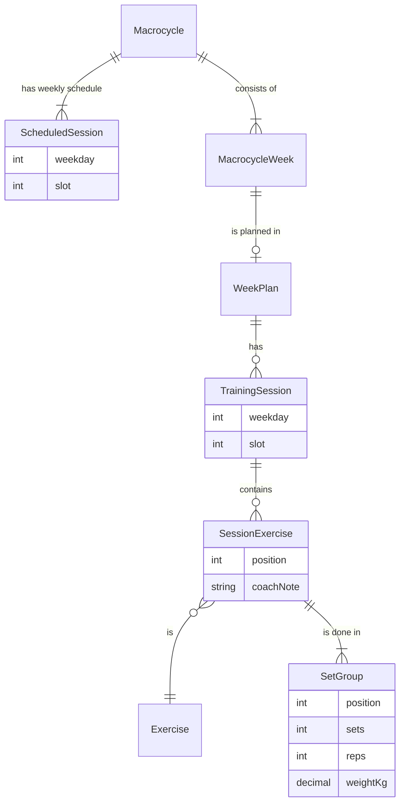

# Design

## Context

- **Macrocycle data:** a macrocycle stores its weeks (`macrocycle_week`:
  week number and level), its three mesocycles and the exercises chosen
  per mesocycle, plus a `training_frequency` number (1–14) in the base
  data.
- **Calculated values:** the planned values per exercise and week (best
  value, average weight, set size, weekly reps) are computed by
  `plannedExercise` and served per exercise by `getExerciseWeeks`.
- **Access rules:** writes are coach-only (`requireOwnAthlete`), and
  reads allow the linked athlete (`requireViewableAthlete`).
  `isCoachOfAthlete` decides what the UI offers.
- **Planning pages:** they live under `/athletes/{id}/macrocycle/…` and
  share an `UnsavedChangesProvider` in that layout; the planning
  `StepIndicator` is a link-based stepper.

## Goals / Non-Goals

**Goals:**
- **Schedule and storage:** the weekly schedule replaces the frequency
  number, and week plans are stored relationally and saved as a whole.
- **One editor page:** two client-side steps, drag & drop with a click
  alternative, and a column slide animation.
- **Pure checks:** the plan's actual values and the deviation check are
  pure, testable functions.

**Non-Goals:**
- **Saving:** no autosave and no saving per field.
- **Collaboration:** no concurrent editing protection beyond
  last-save-wins.
- **Athlete side:** no athlete UI (feature 9).
- **Drag on phones:** no drag & drop on phones; the click path covers
  touch.

## Decisions

### Weekly schedule replaces the training frequency

The new table `macrocycle_session` (macrocycle_id, weekday 1–7, slot 1–3;
key on all three) replaces the column `macrocycle.training_frequency`.
- **Input:** the base data takes `sessions: [{ weekday, slot }]` (1–14, at
  most 3 per day, slots per day contiguous from 1).
- **Responses:** they add `sessions` and keep `trainingFrequency` as the
  count, so the macrocycle view's "Sessions per week" stays.
- **Migration:** in the split add+copy / drop style used before:
  1. Create the table.
  2. Convert each existing frequency into a schedule spread over
     Monday–Saturday: one session per day first, then second and third
     sessions from Monday on, so 8 → Mon 1–2, Tue 1–2, Wed–Sat.
  3. Drop the column.
- **Alternatives:** storing the schedule as a JSON array on the macrocycle
  was rejected, to stay consistent with the relational model used for
  week plans.

The base data form replaces the number input with a schedule picker: a row
of seven day columns, each with "+" to add a session (up to 3) and an ×
on each session to remove the last slot. It is keyboard reachable, with
the count shown below.

### Week plan data model: four tables keyed to the macrocycle week

The tables are `week_plan` (macrocycle_id, week_number, created/updated),
`training_session` (week_plan_id, weekday 1–7, slot 1–3),
`session_exercise` (session_id, position, exercise_number, note) and
`set_group` (session_exercise_id, position, sets, reps, weight_kg
numeric(4,1) nullable).
- **Week plan:** its key is (macrocycle_id, week_number), and it is deleted
  with the macrocycle.
- **Uniqueness:** one session per (week_plan, weekday, slot), and an
  exercise at most once per session.
- **Alternatives:** a JSON document per week was rejected, because the
  feature 9 queries (current week, feedback per exercise) and the
  per-exercise aggregation are clearer relationally.

### Save the week as a whole (PUT replace)

`PUT …/weeks/{week}/plan` validates the full week with Zod and replaces
sessions, exercises and set groups in one transaction.
- **Empty body:** a body without sessions deletes the week plan.
- **Why:** the editor saves explicitly, like the planning steps.
- **Alternatives:** row-level PATCH endpoints were rejected; they add
  ordering and partial-failure complexity without a user need.

### Weekly actual values and deviation as pure functions

The new `week-plan/calculation.ts` computes, per exercise over all
sessions:
- **Heaviest weight:** the maximum weight.
- **mHG:** Σ(sets·reps·weight) / Σ(sets·reps) over the set groups with a
  weight.
- **Set size:** Σ(sets·reps) / Σ(sets).
- **Weekly reps:** Σ(sets·reps).

`deviation(actual, projected)` returns `above` / `below` / `within`, using
a strict 5 % band (|a−p| > 0.05·p). Null on either side gives no
comparison.

The projection comes from `plannedExercise` for the week, the same source
as the exercise chart.

### Mesocycle check

The week's mesocycle follows from the stored borders.
- **Missing:** chosen − on week.
- **Not planned:** on week − chosen.
- **Highlighting:** the chosen set drives the highlighting in the catalog
  column and the selection sheet.

All three are computed in the domain and returned with the plan.

### Initial content of a week

The page loads the content in this order:
1. **Stored plan:** the week's stored plan, as is.
2. **Copy of the previous week:** with `?prefill=previous` and week−1
   planned, a copy of week−1 including the coach notes.
3. **Weekly schedule:** the macrocycle's schedule as sessions without
   exercises.

The page is `/athletes/{id}/macrocycle/weeks/{week}` (server component,
`requireCoachPage` + `getAthlete`). It loads:
- **The macrocycle:** weeks, mesocycles and level.
- **Projections:** for all catalog exercises with values, for that week.
- **The initial content:** as listed above.
- **The catalog:** for the exercise lists.

### Editor layout and steps (client)

One client component holds the draft and the current step in state. The
steps never change the URL, so no route change, reload or unsaved-changes
prompt happens between them.
- **Stepper:** a button-based stepper with the planning stepper's look
  (two steps). The planning stepper's circle and line rendering is shared
  in a small presentational component.
- **Desktop layout (≥ lg):** a track of three equal columns, catalog |
  sessions | values, in a container that shows two at a time.
  - **Step 1:** shows catalog and sessions.
  - **Step 2:** shows sessions and values.
  - **The slide:** only the sessions column is translated
    (`transform: translateX`, 300 ms ease). The catalog fades out under
    it, and the values column fades in on the right; going back reverses
    it.
  - **Reduced motion:** under `prefers-reduced-motion` the transition
    duration is 0.
  - **Alternatives:** sliding the whole track was rejected, because the
    user asked that only the sessions column moves.
- **Phones:** one column.
  - **Step 1:** the session cards, where clicking into a session opens the
    exercise selection as a bottom sheet (`<dialog>`).
  - **Step 2:** the same cards with the set groups under each exercise; no
    slide.
- **Drag & drop:** native HTML5 drag events on desktop.
  - **Sources:** a catalog row (`text/plain`: the exercise number) and an
    exercise's drag handle (`application/x-week-exercise`: session and
    exercise key).
  - **Drop zones:** a session card (append) and an exercise row (insert
    before it).
  - **Moves:** a move into a session that already has the exercise is
    ignored.
  - **Keyboard:** the arrow keys on a focused handle move an exercise up
    or down in its session.
  - **Click path:** "+ Exercise" opens the selection on all screen sizes,
    for keyboards and screen readers.
- **Exercise list:** by default only the mesocycle's chosen exercises,
  each with an icon (dashed circle: not in the week yet; check: in the
  week). "Show all exercises" toggles the full catalog, where the other
  exercises are greyed out (`text-zinc-400`) but remain drag sources and
  buttons.
  - **Alternatives:** a drag & drop library was rejected; it adds a
    dependency, and touch is covered by the click path.
- **Values column:**
  - **Rows:** one block per session exercise, aligned with the sessions
    column, with set group inputs ("sets × reps @ kg", add and remove) and
    the coach note.
  - **Indicators:** each exercise block ends with the week totals
    (heaviest, mHG, set size, reps), each with the projection and red ↑ /
    blue ↓. They are repeated on every block of the same exercise and
    update live.
- **Unsaved changes:** the editor registers a guard with the existing
  provider; the back link gets the same guarded click as the planning
  stepper.

### Entry points

`AthleteHome` gets a "Training week" section when `canEdit` and a
macrocycle exist. It is loaded by `loadTrainingWeeks` with:
- **Weeks:** the current week number and the next week number.
- **Planned weeks:** their numbers and start dates.

Links:
- **Plan next week:** links with `?prefill=previous`.
- **Edit next week:** links without it.
- **Plan this week:** shown for an unplanned current week, with prefill.
- **Planned weeks:** each links to its editor.

### Duration guard

`updateBaseData` refuses a `durationWeeks` below the highest planned week
with the field code `WEEKS_PLANNED`. Start date changes keep week numbers.

## Domain model changes

New entities, using glossary terms:
- **Weekly schedule:** the macrocycle's usual sessions; training frequency
  becomes its count.
- **Week plan:** at most one per macrocycle week.
- **Training session:** a session of a week plan.
- **Session exercise:** an exercise of the catalog in a session, with a
  coach note.
- **Set group:** sets × reps @ weight of a session exercise.

`Macrocycle.trainingFrequency` is no longer stored; it is the count of the
weekly schedule.

## Risks / Trade-offs

- [The frequency migration guesses days for existing macrocycles] → Only
  affects test and early data; the coach can change the schedule, and it
  does not touch week plans.
- [Native drag & drop has rough edges (drag image, no auto-scroll in some
  browsers)] → The click path is always there; drop zones are large
  session cards.
- [The ±5 % band is strict for small integers (set size 3 vs 2 is −33 %)]
  → As specified; the projected value is always shown.
- [Prefill copies weights and notes that may not fit the next week] →
  Intended as a starting point; the step 2 indicators show what to adjust.
- [Red and blue are new colours in a black/white UI] → Used only for
  deviations, always with an arrow and the projected value.

## Migration Plan

1. **Weekly schedule:** add `macrocycle_session` and fill it from
   `training_frequency`, then drop the column (two migrations).
2. **Week plans:** add the four week plan tables.

Rollback:
- **Week plan tables:** drop them.
- **Frequency:** restore the column from the schedule counts.
