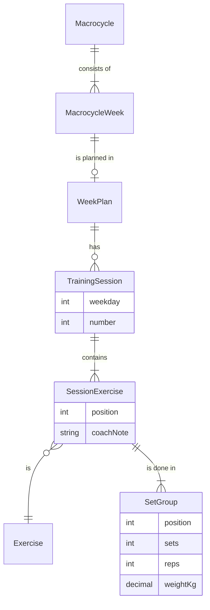

# Design

## Context

- **Existing macrocycle data:** a macrocycle stores its weeks
  (`macrocycle_week`: week number and level), its three mesocycles and
  the exercises chosen per mesocycle.
- **Calculated values:** the planned values per exercise and week (best
  value, average weight, set size, weekly reps) are computed by
  `plannedExercise` and served per exercise by `getExerciseWeeks`.
- **Access rules:** writes are coach-only (`requireOwnAthlete`), and
  reads allow the linked athlete (`requireViewableAthlete`).
  `isCoachOfAthlete` decides what the UI offers.
- **Planning pages:** they live under `/athletes/{id}/macrocycle/…` and
  share an `UnsavedChangesProvider` in that layout.

## Goals / Non-Goals

**Goals:**
- **Editor and storage:** one editor page for any week, with week plans
  stored relationally and saved as a whole.
- **Pure checks:** the plan's actual values and the deviation check are
  pure, testable functions.
- **Shared rules:** prefill and the unsaved-changes guard reuse the
  planning patterns.

**Non-Goals:**
- **Saving:** no autosave and no saving per field.
- **Collaboration:** no concurrent editing protection beyond
  last-save-wins.
- **Athlete side:** no athlete UI (feature 9).

## Decisions

### Data model: four tables keyed to the macrocycle week

The tables are `week_plan` (macrocycle_id, week_number, created/updated),
`training_session` (week_plan_id, weekday 1–7, number 1–3),
`session_exercise` (session_id, position, exercise_number, note) and
`set_group` (session_exercise_id, position, sets, reps, weight_kg
numeric(4,1) nullable).
- **Week plan:** its key is (macrocycle_id, week_number), and it is deleted
  with the macrocycle.
- **Uniqueness:** one session per (week_plan, weekday, number), and an
  exercise at most once per session.
- **Alternatives:** a JSON document per week was rejected, because the
  feature 9 queries (current week, feedback per exercise) and the
  per-exercise aggregation across sessions are clearer relationally, and
  the project keeps relational data elsewhere.

### Save the week as a whole (PUT replace)

`PUT …/weeks/{week}/plan` validates the full week with Zod, then replaces
the week's sessions, exercises and set groups in one transaction.
- **Empty body:** a body without sessions deletes the week plan.
- **Why:** the editor is a form with an explicit "Save" (like steps 1 and
  2), and replacing keeps the API small and atomic.
- **Alternatives:** row-level PATCH endpoints were rejected; they would add
  ordering and partial-failure complexity without a user need.

### Weekly actual values and deviation as pure functions

The new `week-plan/calculation.ts` computes, per exercise over all
sessions of the week:
- **Heaviest weight:** the maximum weight of its set groups.
- **mHG:** Σ(sets·reps·weight) / Σ(sets·reps) over the set groups with a
  weight.
- **Set size:** Σ(sets·reps) / Σ(sets).
- **Weekly reps:** Σ(sets·reps).

`deviation(actual, projected)` returns `above` / `below` / `within`, using
a strict 5 % band (|a−p| > 0.05·p). Null on either side gives no
comparison. Rounding for display is one decimal for weights and set size.

The projection comes from `plannedExercise` for the week, the same source
as the exercise chart, so the editor and the macrocycle view never
disagree.

### Mesocycle check

The week's mesocycle follows from the stored borders. The editor gets the
mesocycle's chosen exercise numbers:
- **Missing:** chosen − on week.
- **Not planned:** on week − chosen.

Both are computed in the domain and returned with the plan, so a future
app gets the same answer.

### Editor page and loading

The page is `/athletes/{id}/macrocycle/weeks/{week}` (server component).
It loads:
- **The macrocycle:** weeks, mesocycles and level.
- **Projections:** for all catalog exercises with values, for that week
  (one calculation pass, no per-exercise requests).
- **The plan:** the stored week plan, or with `?prefill=previous` a copy
  of week−1 without notes when the week is unplanned.
- **The catalog list:** for the exercise picker.

The client editor keeps the draft in state. Its sections:
- **Sessions:** weekday chips plus "add session".
- **Session cards:** one per session, with exercises and set groups as
  "sets × reps @ kg" inputs.
- **Exercise summary:** projection vs actual values, and the mesocycle
  check above the sessions.

It registers an unsaved-changes guard; the back link and the stepper-style
dialog reuse `UnsavedChangesProvider` (the back link gets the same
guarded click as the stepper links). Access goes through
`requireCoachPage` and `getAthlete`, so others get "not found".

### Entry points

`AthleteHome` gets a "Training week" section when `canEdit` and a
macrocycle exist. It is loaded by a `loadTrainingWeeks` helper with:
- **Weeks:** the current week number and the next week number.
- **Planned weeks:** their numbers and start dates.

Links:
- **Plan / Edit next week:** "Plan next week" links with
  `?prefill=previous`; "Edit next week" links without it.
- **Plan this week:** shown for an unplanned current week, with prefill.
- **Planned weeks:** each links to its editor.

### Duration guard

`updateBaseData` refuses a `durationWeeks` below the highest planned week
with a field code `WEEKS_PLANNED` (400 `VALIDATION_FAILED`), shown in the
duration field. Changing the start date keeps week numbers, so plans move
with their week.

## Domain model changes

New entities: **Week plan**, **Training session** (already in the
glossary), **Session exercise** (an exercise of the catalog in a session)
and **Set group**. A Week plan belongs to one week of a Macrocycle (at most
one per week).

## Risks / Trade-offs

- [Two coaches' tabs saving the same week overwrite each other] → A Team
  has one coach; last save wins, acceptable for now.
- [The ±5 % band is strict for small integers (set size 3 vs 2 is −33 %)]
  → As specified by the user; colour always comes with the projected
  value, so the coach sees the size of the gap.
- [Prefill copies weights that no longer fit the next week's projection]
  → Intended as a starting point; the deviation colours show what to
  adjust.
- [Red/blue are new colours in a black/white UI] → Used only for
  deviations, always with an arrow and the projected value, never alone.

## Migration Plan

One Drizzle migration adds the four tables; no data migration. Rollback:
drop the tables (no other table references them).
