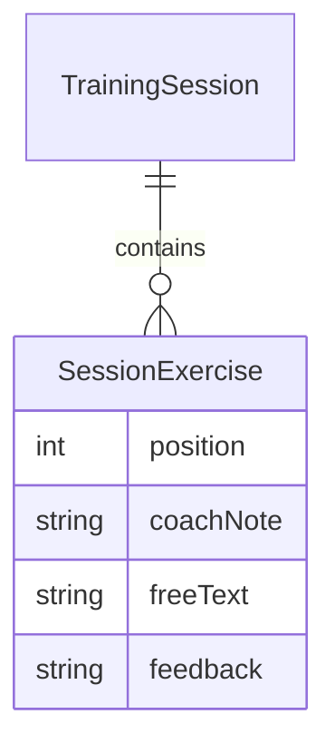

# Design

## Context

- **Athlete page:** `AthleteHome` (athlete details for the coach, "My
  training" for the athlete) renders `TrainingWeekSection` with the entry
  points, loaded by `loadTrainingWeeks` (`getTrainingWeeks`).
- **Week plans:** they are stored per macrocycle week with sessions →
  session exercises (note, free text) → set groups.
  - **Saving:** `saveWeekPlan` replaces the week in one transaction.
  - **Reading:** `getWeekPlan` is readable by the coach and the linked
    athlete (`requireViewableAthlete`).
- **Editor table:** the step 2 table (`SessionTable`) has fixed column
  widths (`WIDTH`, 60 rem), expands set groups into single sets, and gives
  exercises from 30 on a free text.

## Goals / Non-Goals

**Goals:** show the current week read-only with the same table look;
feedback per session exercise, written by the linked user, kept across
editor saves.

**Non-Goals:** browsing weeks, logging done sessions or lifted weights,
notifications.

## Decisions

### Feedback stored on the session exercise, kept by (weekday, slot, exercise)

A nullable `feedback` text column on `session_exercise` (migration).
`saveWeekPlan` reads the week's existing feedback into a map keyed by
`weekday.slot.exerciseNumber` inside the transaction, replaces the week as
before, and writes the matching feedback back on the new rows.
- **Moved or removed:** an exercise moved to another session or removed
  loses its feedback, as specified.
- **Editor payloads:** they carry no feedback, so the coach cannot change
  it through a plan save.
- **Alternative rejected:** a separate feedback table keyed by (week plan,
  weekday, slot, exercise) would survive deleted rows, but it would also
  keep feedback for exercises that are gone and adds a join for nothing.

### Feedback write

`setFeedback(user, athleteId, weekParam, { weekday, slot, exerciseNumber,
feedback })`:
- **Access:** only the user whose roles link them to that Athlete. A coach
  who is not linked gets `NOT_THE_ATHLETE` (403); unrelated users get
  `ATHLETE_NOT_FOUND`.
- **Target:** it finds the session exercise of the planned week, otherwise
  `EXERCISE_NOT_IN_WEEK` (404).
- **Value:** it trims the text, stores up to 500 characters, and empty
  clears it.

The route is
`PUT /api/athletes/{id}/macrocycle/weeks/{week}/plan/feedback`. A
dedicated small write, not the whole-week PUT, keeps the athlete away from
the plan.

### Current week loading

`getCurrentWeek(user, athleteId, today)` (coach and linked athlete)
returns:
- **State:** `before` (with the start date), `after`, or `week`.
- **Week:** in the `week` state, the `WeekPlan` of the current week (with
  `planned` false when there is no plan), including the feedback and the
  calendar week.
- **Coach links:** the next week's number and planned flag, for the coach
  tools.

The page loader passes `canEdit` (coach of the Team) and `canGiveFeedback`
(the user is linked to the Athlete), both decided in the domain
(`isCoachOfAthlete`, roles).

Calendar week: the ISO 8601 week number of the week's Monday, as a pure
function in `week-plans/calculation.ts` (2027-02-08 → 6).

### Read-only table sharing the editor's widths

`WeekViewTable` is a client component in `components/week-plans`.
- **Shared with the editor:** `WIDTH` and the set expansion move into a
  small shared module, so both tables use the same widths and the same
  sets-from-groups logic.
- **Columns:** exercise, kg/reps label, ten sets, coach note, feedback.
  The value-label and indicator widths go to the feedback column (13.75
  rem), so the total stays 60 rem.
- **Cells:** set cells, the note and the free text are plain text.
- **Feedback:** a `textarea` for the linked user, plain text otherwise.

The editor's step 2 shows the feedback as muted text below the coach note
in the same cell.

### Automatic feedback saving

Each feedback field saves 600 ms after the last keystroke, with one save
at a time per field, and shows "Saving…" / "Saved" / "Could not save"
next to the field. Saves are sequential, as in the editor; there is no
leave guard, because one field rarely has unsaved text when leaving and
the debounce is short.

### Section layout

`TrainingWeekSection` is restructured:
- **Order:** heading "Training week", the header line, then the coach
  tools (only `canEdit`), then the session tables.
- **States:** "No plan for this week yet", "The macrocycle starts on …",
  or "The macrocycle has ended".
- **Removed:** the list of planned weeks, and `AthleteHome`'s placeholder
  text.
- **Phones:** the tables scroll sideways, with the exercise column sticky
  (as in the editor).

## Domain model changes

`SessionExercise` gains the athlete's `feedback`.

## Risks / Trade-offs

- [Athletes mostly use phones, and the feedback column is at the right of
  a wide table] → The table scrolls sideways with the exercise name
  sticky; the feedback cell is large. A phone-specific layout can follow
  if needed.
- [Feedback is lost when the coach moves an exercise to another day] → As
  specified; the coach sees the feedback in the editor before changing.
- [Concurrent edits: the coach saves while the athlete types] → The
  feedback map is read inside the save transaction, so a stored feedback
  is kept; a feedback saved during the coach's save may race, and the
  athlete's next keystroke saves again.

## Migration Plan

One migration adds `session_exercise.feedback` (nullable). Rollback: drop
the column.
