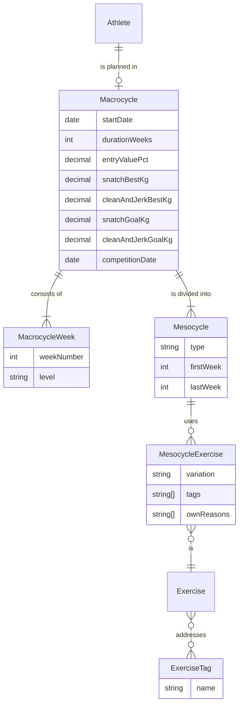

# Design

## Context

See proposal.md; requirements in the `macrocycle-planning`,
`macrocycle-calculation` and `athlete-details` deltas. Built so far: Team,
Athlete, the exercise catalog (`exercise` with best value, max. weekly
average weight, reps per set/week, reference lift; catalog number as key),
the athlete details page `/athletes/{id}` (header only), coach-only pages
via `requireCoachPage`, forms keyed by `bfcacheId`, PGlite tests, the
minimalist black-and-white UI and the tab navigation. The calculation rules
were given by the user on 2026-11-16 (sine curve, ±5 points, t = (k−1)/(N−1),
mesocycle split 15/50/35, volume = sum of weekly reps).

## Goals / Non-Goals

**Goals:**
- One pure calculation module used by API, pages and later the weekly
  planning, so all screens show the same numbers.
- Store only what the coach decides (base data, week levels, mesocycle
  borders and exercises); calculate everything else on read.

**Non-Goals:** macrocycle view (feature 7), athlete access, several cycles,
adjustable mesocycle borders, taper/transition blocks.

## Decisions

### Tables
| Table | Columns |
|---|---|
| `macrocycle` | `id` uuid PK; `athlete_id` uuid FK → `athlete` (cascade), **unique**; `start_date` date; `duration_weeks` smallint; `entry_value_pct` numeric(4,1); `snatch_best_kg`, `clean_and_jerk_best_kg`, `snatch_goal_kg`, `clean_and_jerk_goal_kg` numeric(5,1); `body_weight_kg`, `target_body_weight_kg` numeric(5,1); `body_fat_pct`, `muscle_mass_pct` numeric(4,1) null; `deficits`, `injuries_and_illnesses`, `strengths`, `experience`, `competition_type` text; `training_frequency` smallint; `focus_points` text[] (1–3, ordered); `competition_date` date; `created_at`, `updated_at` |
| `macrocycle_week` | PK (`macrocycle_id`, `week_number`); `level` enum `week_level` (`high`, `medium`, `low`) |
| `mesocycle` | `id` uuid PK; `macrocycle_id` FK (cascade); `type` enum `mesocycle_type` (`general_preparation`, `special_preparation`, `competition_preparation`); `first_week`, `last_week` smallint; unique (`macrocycle_id`, `type`) |
| `mesocycle_exercise` | PK (`mesocycle_id`, `exercise_number`); `exercise_number` FK → `exercise.number` |

- Unique `athlete_id` enforces one macrocycle per athlete (409
  `MACROCYCLE_EXISTS`).
- All week rows exist (N rows) so levels are explicit; changing the duration
  keeps existing levels, adds medium weeks or removes surplus weeks, and
  re-divides the mesocycles by default while keeping each mesocycle's
  exercises (they belong to the mesocycle type).
- Mesocycle borders are stored and adjustable in step 2 (added during
  acceptance). A duration change scales the stored block lengths:
  `general = max(1, round(g·N′/N))`, `special = max(1, round(s·N′/N))`,
  reduced if needed so that `competition = N′ − general − special ≥ 1`.

### Calculation module `src/domain/macrocycles/calculation.ts` (pure)
- `cycleProgress(k, N) = (k−1)/(N−1)`.
- `curveShape(t) = (sin(t·π − π/2) + 1) / 2` (0 → 1).
- `intensity(E, t, level) = E + (1 − E)·curveShape(t) + {high: +0.05, low:
  −0.05, medium: 0}` — algebraically identical to the user's formula.
- `plannedBestKg = roundKg(intensity × bestValuePct/100 × goal)`,
  `plannedAverageKg` likewise with `maxWeeklyAverageWeightPct`; null when a
  value or the reference lift is missing.
- `plannedSetSize = round(max − (max − min)·curveShape(t))`;
  `plannedWeeklyReps = round((max − (max − min)·curveShape(t)) × {high:
  1.05, low: 0.95, medium: 1})`; null without catalog reps.
- `volume(week) = Σ plannedWeeklyReps` of the week's mesocycle exercises
  (null when the mesocycle has none, exercises without reps count 0).
- `splitMesocycles(N)`: general `floor(0.15N)`, special `floor(0.5N)`,
  competition the rest.
- Rounding: weights to whole kilograms and reps to whole numbers, halves
  up (user decision), intensity shown with one decimal. Floating-point results are rounded
  before comparison in tests.
- Exhaustive unit tests with the spec's example values.

### Domain functions `src/domain/macrocycles`
`getMacrocycle(coach, athleteId)` (with calculated `weeks[]`: number,
start date, mesocycle, level, intensity, volume, and per mesocycle exercise
the planned values), `createMacrocycle`, `updateBaseData`, `setWeekLevel`,
`setMesocycleExercises`. All scoped through `requireCoachTeam` and the
athlete's Team (`ATHLETE_NOT_FOUND` otherwise); validation with Zod in the
domain (`DomainValidationError`), including "start date is a Monday",
ranges and `MACROCYCLE_EXISTS`.

### HTTP API
| Method and path | Purpose |
|---|---|
| `GET /api/athletes/{id}/macrocycle` | macrocycle with calculated weeks (404 `MACROCYCLE_NOT_FOUND`) |
| `POST /api/athletes/{id}/macrocycle` | step 1, create (201; 409 `MACROCYCLE_EXISTS`) |
| `PATCH /api/athletes/{id}/macrocycle` | step 1, change base data (not the SWOT) |
| `PUT /api/athletes/{id}/macrocycle/swot` | step 2, all SWOT fields (strengths, deficits, experience, focus points, injuries and illnesses) |
| `PUT /api/athletes/{id}/macrocycle/weeks/{week}` | `{ level }` |
| `PUT /api/athletes/{id}/macrocycle/mesocycles/{type}/exercises/{number}` | choose or change one exercise: `{ reason, variation? }` (reason 1–500, variation ≤ 200 characters) |
| `DELETE /api/athletes/{id}/macrocycle/mesocycles/{type}/exercises/{number}` | remove one exercise (204) |
| `PUT /api/athletes/{id}/macrocycle/mesocycles/borders` | `{ specialPreparationStart, competitionPreparationStart }` (week numbers; each block ≥ 1 week) |

### Pages (coach only, under the athlete)
- `/athletes/{id}/macrocycle/base-data`, `/intensity`, `/exercises`, with a
  step indicator (1 · 2 · 3) and "Continue" / "Back"; "Finish" in step 3
  returns to `/athletes/{id}`. Steps 2 and 3 need an existing macrocycle
  (otherwise redirect to step 1).
- Base data form: same pattern as the athlete form (native inputs,
  `noValidate`, server field errors, keyed by `bfcacheId`); the date input
  for the start date offers the next Monday by default.
- Exercise selection: the catalog grouped by exercise group with a checkbox
  per exercise, one tab per mesocycle; saved per mesocycle.
- Athlete details page: macrocycle section (placeholder) with "Plan
  macrocycle" or period, competition and "Change planning".

### Macrocycle chart (custom SVG, no chart library)
(Adjusted after loading the `dataviz` skill: no second y-axis. Intensity and
volume are two charts stacked on the same week axis in one scroll container,
plus a tooltip per week and a table view.)
- Follows the `dataviz` skill's guidance (to be loaded before writing the
  chart): x = weeks (labels every few weeks, calendar week numbers),
  left y-axis intensity 50–110 %, line with a handle (circle, ≥ 44 px touch
  target) per week; volume as a separate bar chart below (same columns)
  once exercises exist; mesocycle bands as three neutral grey shades behind the plot with a
  legend (staying in the black-and-white style); high/low weeks additionally
  marked with ▲/▼ above/below the handle so the level is not conveyed by
  position alone.
- Handles: pointer drag snaps to the three positions (curve −5, curve,
  curve +5); a tap on the upper or lower half of a week's column moves one
  step; each handle is a focusable `role="slider"` with `aria-valuetext`
  ("Week 11, high, 85 %") and arrow keys. Each change calls the week API
  immediately (optimistic update, reverted with a message on failure).
- Width: at least 28 px per week; wider cycles scroll horizontally inside
  the chart container on phones (the page itself does not scroll sideways).

### Styling and palette
Minimalist black and white. Wherever colour is needed, the app uses the
user's 90s/vintage palette (decided 2026-11-16 during acceptance; it
replaced a first set of muted red/yellow/green tints), defined once as
tokens in `globals.css` (`--color-palette-purple` #6f3ab1, `-magenta`
#ba2db3, `-cyan` #3bc8c8, `-lime` #d7f212) and available as Tailwind
colours:
- mesocycle bands in full colour: general preparation purple, special
  preparation magenta, competition preparation cyan; lime is reserved for
  the next use of colour.
- The palette mixes dark (purple, magenta) and light (cyan, lime) colours,
  so the curve, points, ▲/▼ markers and the hover line are white with a
  dark outline (halo) and readable on every band; gridlines are a
  translucent black hairline.
- The `dataviz` validator reports purple vs magenta as hard to tell apart
  (normal ΔE 14.5, protan 3.3) and purple below 3:1 on the dark surface.
  Accepted as the user's palette because identity never relies on colour:
  band labels, the border lines with handles and the legend name the
  blocks; purple is not used as text colour on dark backgrounds.

### Main competition marker (added during acceptance)
- x = plot start + column × (days since the start date / 7), so the line is
  at the exact day (the week's point is its Monday). After the last week:
  clamped to the right edge.
- Dashed white line (2 px) with the dark chart halo, not interactive. The
  label "{type} · {date}" sits above the plot in the row and style of the
  mesocycle labels (11 px, secondary grey), ending at the line in the right
  half of the chart and starting at it in the left half; the type is
  shortened to the plot width. Mesocycle labels it would overlap are hidden
  (the legend names them). `role="img"` with an aria-label; legend entry
  "Main competition" with a dashed swatch.

### Base data and SWOT steps (changed during acceptance)
- Planning has four steps: `/base-data`, `/swot`, `/intensity`,
  `/exercises`. Step 1 has the sections "Historical data" (personal bests,
  body weight, body fat, muscle mass) and "New macrocycle plan" (period,
  main competition, entry value, goals, target body weight, sessions per
  week). Step 2 (SWOT): strengths, deficits, experience, focus points,
  injuries and illnesses (placed last: the user listed the first four; the
  injuries field followed the training frequency before).
- Creating a macrocycle (POST) takes only the step 1 fields; the SWOT
  columns start empty ('' and no focus points) and are set as a whole with
  `PUT …/swot` (all required). PATCH no longer accepts SWOT fields. No
  migration needed: existing rows keep their values.
- One form component with a `part` ("base" | "swot") shares the field
  rendering and error handling.

### Deficits and reason tags (changed during acceptance)
- Base data: `deficits` is split into snatch, clean, jerk and other
  deficits (all required, 2000 characters each). Migration: the old text
  becomes the other deficits; the three new fields start empty and must be
  filled in at the next save of step 1.
- Catalog: a new "Addresses" column (merged from the user's
  `Trainingsmittelkatalog_mit_tags.csv` into the cleaned catalog source;
  names normalised: first letter upper case, duplicates by case merged,
  "Extrimitäten" corrected, "-" = none) with English names in
  `translations.en.json` (`tags`). Tables `exercise_tag` (German name as
  key, English name) and `exercise_addresses` (exercise, tag, position),
  filled by the generated catalog data migration.
- A choice's reason = `tags` (text[] of tag keys, each one the exercise
  addresses) plus own reasons (first a single `note`, later
  `own_reasons`, see below); at least one is required
  (field code `reason: REQUIRED`, unknown tags `tags: UNKNOWN_TAG`).
  Migration: the old reason becomes the note.
- Dialog order for a fast flow: deficits for the reference lift (snatch →
  snatch; clean & jerk → clean and jerk; none without a reference lift;
  each under its own small bold title, no section title), then tag toggle
  buttons (`aria-pressed`) ending with a "+" tag that opens an inline text
  field for own reasons, then the variation. No hint text under "Reason".
- Own reasons (changed again): any number, stored as `own_reasons text[]`
  (≤ 10, each ≤ 200 characters, no duplicates), replacing `note`
  (migrations 0013 copy note → [note], 0014 drop note). In the field,
  Enter adds the text and closes the field (a new "+" follows), a comma
  adds the text and keeps the field open for the next one (also for pasted
  text), X discards the text. Own reasons are selected tags with an ×
  button. Pending text in the field counts when the dialog is saved.
- A "+" for an exercise already chosen in another block prefills the
  dialog from the first such block (GPB, SPB, CPB order): tags, own
  reasons, variation. The catalog's exercise details
  list the addressed points.

### Exercise table (changed during acceptance)
- Step 3 is one table instead of three tabs: rows = catalog exercises under
  group header rows, columns = exercise, GLP, ABP, LAP (column headers with
  the palette swatch of the block and its weeks). Each cell is a button:
  empty cells show "+", chosen cells a check mark and, from `sm` up, the
  variation (no text without a variation). The button opens a dialog (exercise, block, catalog comment as
  hint, variation, required reason, Save / Remove / Cancel).
- Above the table: the four deficits in the dialog's style (bold title,
  text; two columns from `sm` up) instead of the help text. Below: a
  `tfoot` row "Total" with the number of chosen exercises per mesocycle,
  from the local state.
- Variation and reason are stored per mesocycle choice
  (`mesocycle_exercise.variation`, `.reason`); they are information only.
  Existing choices get an empty reason; their cell is marked "Reason
  missing" until the coach adds one.
- The bulk `PUT …/exercises` is replaced by per-exercise `PUT`/`DELETE`, so
  one choice never overwrites the reasons of the others.

### Chart simplification (changed during acceptance)
- No keyboard control of week handles and borders, no table view, and no
  volume bar chart in step 2 (user decisions): dragging and tapping change
  the chart; the tooltip shows every week's values. (Later: the tooltip
  shows no volume either; see the tooltip content in the spec.)
  Trade-off accepted by the user: the planning chart cannot be operated
  with the keyboard alone, deviating from the `dataviz` guidance of a
  table view.
- Axis titles: "Week" under the x-axis, "Intensity" beside the y-axis.
- The chart always fits its container width (no horizontal scrolling):
  the column width is the available width divided by the number of weeks,
  smaller margins on phones, points and hit areas scale with the column
  width (point radius at least 2.5 px), week numbers thin out accordingly.

### Week positions (changed during acceptance)
Each week's point, handle and x-axis number sit at the start (left edge) of
the week's column instead of its centre, so a mesocycle border is exactly at
the point of the block's first week. The week's hit area is still its whole
column; volume bars start at the column's left edge; the tooltip is placed
beyond the column on the right or left.

### Border handles and tooltip placement (added during acceptance)
- Each of the two borders is a vertical hairline across the intensity chart
  with a grip at the top (≥ 44 px touch target), `role="slider"` with
  `aria-valuetext` ("Special preparation block from week 4") and
  left/right arrow keys. Dragging snaps to week boundaries and stops so
  every block keeps at least one week; on release the new borders are saved
  (optimistic, reverted on failure).
- The tooltip is placed away from the hovered point: horizontally on the
  side of the point with more room (left of points in the right half), and
  vertically in the half of the plot the point is not in, so it covers
  neither the point nor the pointer, which is on the point's column.

## Domain model changes

- An Athlete has at most one Macrocycle; it belongs to the athlete's Team
  and is planned by its coach.
- A Macrocycle consists of its weeks (each high, medium or low) and is
  divided into three Mesocycles: general preparation, special preparation
  and competition preparation block.
- A Mesocycle uses exercises from the exercise catalog, each with a reason
  (tags the exercise addresses and/or own reasons) and optionally a
  variation; the same exercise can be used in several mesocycles with
  different variations and reasons.
- Each catalog exercise addresses an ordered list of tags; a tag can be
  addressed by several exercises.
- The macrocycle's base data is split into the base data and the SWOT.
- Intensity, planned weights, reps and volume are calculated, not stored.

## Risks / Trade-offs

- [Drag handles are fiddly on phones with many weeks] → Minimum week width
  with horizontal chart scrolling, large touch targets, tap and keyboard
  alternatives.
- [Assumptions in the proposal may be wrong] → They are isolated in the
  calculation module and the validation schema; tests name them.
- [Changing the duration re-divides mesocycles] → Exercises stay with their
  mesocycle type; week levels stay by week number.
- [Floating-point rounding (e.g. 5.5 → 6, 136.5 → 137)] → Explicit rounding
  helpers with tests at the spec's example values.

## Migration Plan

One schema migration (four tables, two enums). Rollback: drop them.
Migration 0008 adds `variation` (nullable) and `reason` (empty for existing
rows) to `mesocycle_exercise`.
