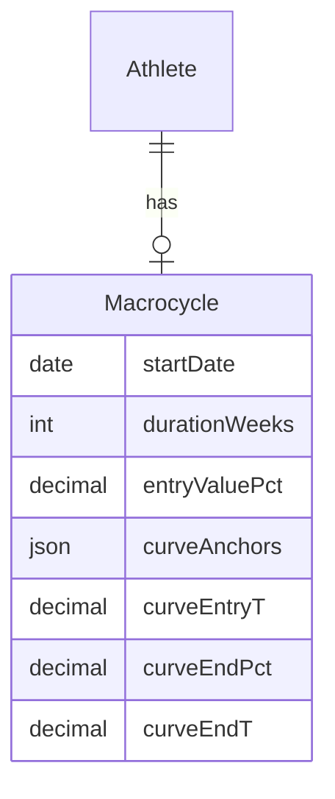

# Design

## Context

See proposal.md - Why.

- **Calculation today:** `calculation.ts` computes the intensity as
  `intensity(entryValue, t, level)`, the sine curve plus ±5 points. Callers:
  - `macrocycles.ts`, which builds every week's `intensityPct` and the
    exercises' planned values through `plannedExercise`;
  - the week editor's projections and the macrocycle view, both through
    `macrocycles.ts`.
- **Entry value:** `macrocycle.entry_value_pct` (`numeric(4,1)`), validated
  30–95 in `base-data.ts`.
- **Step 3:** `IntensityPlanner` renders `MacrocycleChart` → `WeekChart`
  with week handles and border sliders. Each change is a `PUT` that returns
  the whole `Macrocycle`.

## Goals / Non-Goals

**Goals:**
- **One calculation:** a single pure spline function used by the server
  (source of truth) and by step 3 for live previews while dragging.
- **Existing plans:** they get two anchors approximating their former
  curve.

**Non-Goals:**
- Undo/redo, keyboard editing of anchors (anchors keep accessible names;
  the API allows a later keyboard UI).

## Decisions

1. **Storage: `macrocycle.curve_anchors jsonb not null default '[]'`.**
   - **Content:** the inner anchors as `[{ "t": number, "pct": number }]`,
     sorted by `t`. The entry anchor is `entry_value_pct` and the end
     anchor is the constant 100 %, so they are never stored twice.
   - **Alternative:** a separate `curve_anchor` table. A JSON array is
     enough for an ordered list read and written as a whole.

2. **Migration of existing rows.**
   - **Values:** the same migration sets, for every existing macrocycle,
     two inner anchors (user decision): t = 1/3 with `E + (100 − E) · 0.25`
     and t = 2/3 with `E + (100 − E) · 0.75`, rounded to 0.1. These are the
     sine curve's values at these positions, so the curve dips below the
     straight line early and rises above it late. They are computed in SQL
     from `entry_value_pct` in an `UPDATE`.
   - **Accuracy:** the natural spline through these 4 points differs from
     the sine by at most 1.2 points (E = 60 %) or 2.0 points (E = 30 %),
     which the user accepted since there are only test macrocycles. A unit
     test pins the bound.

3. **Spline:** `curveValue(entryPct, anchors, t)` in `calculation.ts`.
   - **Method:** a natural cubic spline (second derivative 0 at both ends)
     through (0, E), the inner anchors and (1, 100), solved with the
     tridiagonal algorithm. With two points it is the straight line.
     Results are capped to 0–100.
   - **Intensity:** `intensity(curve, t, level)` = `curveValue` + the level
     offset (high +5, low −5, uncapped as today). `plannedExercise` takes
     the curve instead of the entry value.
   - **Shared:** the module stays free of server imports, so step 3 can
     preview the curve while an anchor moves. The saved response replaces
     the preview.

4. **API: `PUT /api/athletes/{id}/macrocycle/curve`** with body
   `{ entryValuePct, anchors: [{ t, pct }] }`.
   - **Validation (Zod):** `t` in (0, 1), at least 0.001 apart (equal
     positions would break the spline); `pct` 0–100 with one decimal; at
     most 20 anchors; `entryValuePct` 30–95 with one decimal.
   - **Changes:** it updates `entry_value_pct` and `curve_anchors` in one
     statement and returns `getMacrocycle`.
   - **Access:** coach only, through the same checks as the other planning
     routes.
   - **Alternative:** putting the curve into `PATCH …/macrocycle` would mix
     it with the base data form's full-field validation.

5. **Base data.** Changing the entry value in step 1 changes the entry
   anchor; the inner anchors stay. Since the entry anchor is the entry
   value itself, nothing else is needed.

6. **UI: curve mode of `WeekChart`.** A new prop
   `curve?: { entryPct; anchors; onChange(entryPct, anchors) }` switches the
   chart to curve mode.
   - **Drawing:** the curve is sampled densely (every 2 px) from
     `curveValue`, so it is the real spline, not the week points. The
     anchors are pink circles with a surface ring. The entry and end anchors
     move in any direction, stay before or after the inner anchors, and show
     their value as text while moved.
   - **Gestures** (pointer events with capture, like the week handles):
     - **Add:** pointerdown on the plot outside an anchor adds an anchor
       at the pointer.
     - **Drag:** pointerdown on an inner anchor starts a drag, and its
       position follows the pointer continuously (t from x, pct from y,
       clamped).
     - **Remove:** a pointerup without movement on an inner anchor removes
       it, and so does a drop within 10 px (horizontally) of a neighbouring
       anchor; the anchor fades while a drop would remove it.
     - **Entry anchor:** dragging it sets the entry value, clamped to 30–95
       and rounded to 0.1.
   - **Saving:** each finished gesture calls `onChange` once, and
     `IntensityPlanner` saves it, optimistically and reverted on failure
     like the week levels.
   - **Alternative:** a separate chart component. The chart is meant to
     stay one element with parameters, and the curve mode is one more
     parameter.

7. **Two steps instead of a switch** (user decision).
   - **Steps:** `PLANNING_STEPS` gets `curve` between `swot` and
     `intensity`. `IntensityPlanner` takes `mode: "curve" | "weeks"` from
     the step; the curve step passes the curve editor, the weeks step the
     handles and sliders.
   - **Buttons and labels:** each step has its own continue/back buttons,
     and the stepper labels are "Curve" and "Weeks".
   - **Shared scale:** both steps use the fixed domain 0–110 %.
   - **Dip warning:** `dips(curve)` samples the spline at 400 points and
     reports any fall.

8. **Outer anchors:**
   - **Positions:** they snap to week positions `k / (n − 1)`, bounded by
     the nearest inner anchor.
   - **Values:** the entry value is rounded to whole percents and stays at
     least 1 point below the end value; the end value stays at least 1
     point above the entry value. The API also rejects an end value not
     above the entry value (`NOT_ABOVE_ENTRY`).

## Domain model changes

`Macrocycle` gains `curveAnchors` (the inner Anchors of its Progression
curve) and the end anchors' positions and end value (the entry anchor's
value is `entryValuePct`):

## Risks / Trade-offs

- **[Risk]** A natural spline bulges between close anchors (for example
  above 100 %). → The curve is capped to 0–100 % (user decision), and the
  chart shows the capped curve; high weeks may still go beyond 100 %.
- **[Risk]** Existing (test) plans shift by up to 1.2–2.0 percentage
  points. → Accepted by the user; a unit test pins the bound.
- **[Risk]** Clicking an anchor to remove it can be triggered by accident
  when the coach meant to drag. → A movement of more than 3 px counts as a
  drag; a click on the plot adds the anchor back.
- **[Trade-off]** The client previews with the shared function; the server
  stays the source of truth through the response.

## Migration Plan

1. Run the migration: it adds the column and fills existing rows.
2. Deploy the app.

Rollback: the column can stay; older code ignores it.
