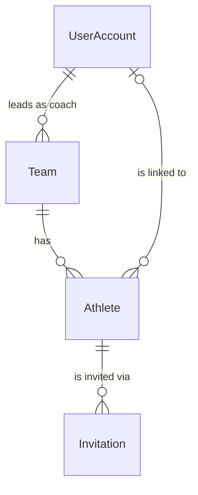

# Domain model

How the domain entities relate to each other, at a conceptual level.
Training terms are defined in [glossary.md](glossary.md); app and role
terms use their English names. Technical details (tables,
keys, columns) belong in each change's `design.md` and in the code.

## How this file is maintained

- A change that adds or changes entities or relations describes them in a
  "Domain model changes" section of its `design.md`. That is where they are
  reviewed.
- When the change is implemented, those changes are applied here. This file
  therefore shows only what is built.

## Current model

Nothing is built yet.

## Draft (not yet built)

Starting point from `feature_list.txt`. Changes that build these parts move
them into "Current model" above.

- A user account is created by signing in with Google or Apple. It has no
  role by itself; a coach is a user account in the coach role of a Team.
  Roles are per Team, not global.
- A coach creates an Athlete in their Team before the athlete has an account.
- An Invitation belongs to one Athlete. When someone signs in through it,
  their user account is linked to that Athlete.
- A coach can train themselves: their user account is then also linked to
  an Athlete in their own Team.

### Open questions

- Can a Team have more than one coach?
- Can one user account be linked to Athletes in several Teams?
- Can an Invitation be used more than once, and does it expire?
