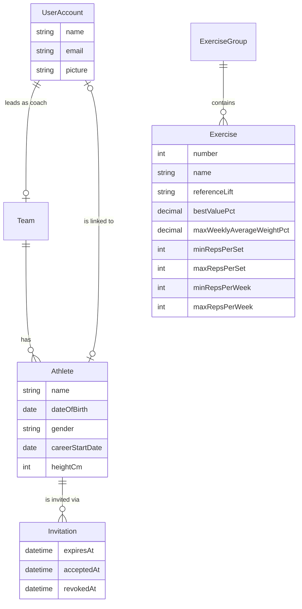

# Domain model

How the domain entities relate to each other, at a conceptual level.
Training terms are defined in [glossary.md](glossary.md); app and role
terms use their English names. Technical details (tables,
keys, columns) belong in each change's `design.md` and in the code.

## How this file is maintained

- A change that adds or changes entities or relations describes them in a
  "Domain model changes" section of its `design.md`. That is where they are
  reviewed.
- When the change is implemented, those changes are applied here. This file
  therefore shows only what is built.

## Current model

- The exercise catalog consists of exercise groups (K1–K9), each with its
  exercises. Exercises are identified by their catalog number. The catalog
  is shared by all Teams and read-only; later changes reference exercises
  from mesocycles and weekly plans and add per-athlete adjustments of the
  values.
- A user account is created by the first sign-in with Google and is
  identified by that Google account. Name and picture follow the Google
  profile on every sign-in.
- Roles are per Team and derived from the data: a user account is the coach
  of the Team it leads (created with "Start as Coach") and an athlete of the
  Team whose Athlete it is linked to. It leads at most one Team and is
  linked to at most one Athlete; it can hold both roles, in the same Team or
  in different Teams. A user account without either role chooses one on the
  start page.
- A Team has exactly one coach. An Athlete belongs to exactly one Team and is
  created by its coach.
- Email address and profile picture are part of an athlete's basic data but
  come from the linked user account; they are not stored on the Athlete.
- An Invitation belongs to one Athlete, can be accepted once, expires after
  7 days and is replaced by a newer Invitation for the same Athlete.
  Accepting it links the accepting user account to the Athlete.
- A coach can link themselves to an Athlete of their own Team without an
  Invitation ("This is me").

## Draft (not yet built)

Nothing is drafted at the moment. Changes for training planning
(macrocycles, mesocycles, weekly plans) add their parts here or directly in
their `design.md`.

### Decisions (answered by the user on 2026-11-15)

- A Team has exactly one coach.
- A user account is linked to at most one Athlete, in one Team.
- An Invitation can be used once and expires after 7 days. The coach can
  create a new one at any time; the previous one then stops working.
- A coach trains themselves by linking their own user account to an
  Athlete in their own Team ("This is me"), without an invitation.
- A user account can be the coach of one Team and at the same time be
  linked to an Athlete in another Team; it is still linked to at most one
  Athlete overall.
- Users whose automatically created Team has no athletes lose it when user
  roles are introduced and choose their role again.
